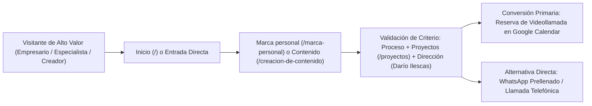
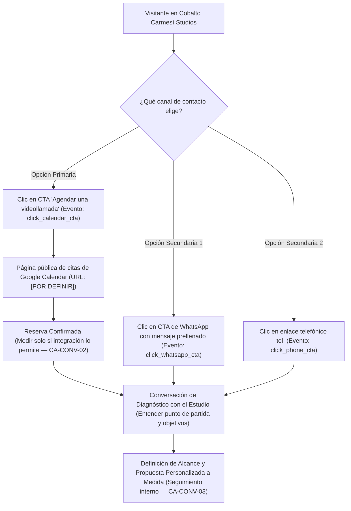

# Estrategia de Producto y Arquitectura del Sitio · Cobalto Carmesí Studios

**Status:** Ready for Review  
**Version:** 1.0  
**Last updated:** 2026-10-23  
**Author / Role:** `product-strategist` (V3.2 — Modo Lite)  
**Skills applied:** `governance-check`, `project-discovery`  
**Approved decisions relied on:** `D-001` a `D-006` ([`docs/00-project/decisions.md`](file:///c:/Users/ederb/Studio/04-cobalto-carmesi/docs/00-project/decisions.md))  
**Canonical sources:** [`inputs/business/Cobalto_Carmesi_Documento_Maestro_Web.md`](file:///c:/Users/ederb/Studio/04-cobalto-carmesi/inputs/business/Cobalto_Carmesi_Documento_Maestro_Web.md), [`PRODUCT.md`](file:///c:/Users/ederb/Studio/04-cobalto-carmesi/PRODUCT.md), [`VALIDATION.md`](file:///c:/Users/ederb/Studio/04-cobalto-carmesi/VALIDATION.md), [`docs/00-project/discovery.md`](file:///c:/Users/ederb/Studio/04-cobalto-carmesi/docs/00-project/discovery.md)

> **Gobernanza V3.2 (`PROPOSAL ≠ DECISION ≠ APPROVAL`):** Este documento consolida las decisiones aprobadas por el cliente (**Darío Ilescas Cruz**) y el propietario del proyecto (`D-001` a `D-006`), y estructura las recomendaciones estratégicas (`RECOMMENDATION`) necesarias para ejecutar Contenido (`docs/02-content/`) y Diseño (`docs/03-design/`). Ningún dato marcado como `[POR DEFINIR]` se inventa ni puede salir a producción (`CA-COMM-03`).

---

## 1. Visión Estratégica, Posicionamiento y Propuesta de Valor

### 1.1 Transición Estratégica: De *Sefirot* a *Cobalto Carmesí Studios* (`DECISION D-001`, `D-002`)
El proyecto ejecuta el reposicionamiento integral del estudio bajo la dirección creativa de **Darío Ilescas Cruz** (`FACT-002`):

| Dimensión | Etapa Anterior (*Sefirot* — `sefirot.com.mx`) | Posicionamiento Actual (*Cobalto Carmesí Studios*) | Regla Estratégica de Ejecución |
|---|---|---|---|
| **Eje del negocio** | Grabación con drones, imagen aérea y supervisión de obra con mensajes dispersos (`FACT-001`, `FACT-011`). | **Arquitectura de marca personal** y **creación de contenido** para clientes de alto valor (`FACT-004`, `D-002`). | La marca personal y el contenido encabezan la experiencia, el hero de `Inicio` y el menú principal (`CA-COMM-04`). |
| **Rol de drones y eventos** | Protagonistas históricos del discurso comercial y portafolio. | Capacidades **complementarias** (`F` y `E`) integradas al catálogo con rutas específicas (`FACT-005`). | Prohibido que dominen la portada o recuperen el enfoque de supervisión de obra (`D-002`, `CA-COMM-04`). |
| **Promesa comercial** | Cifras sin contexto y textos genéricos de plantilla en inglés (`FACT-011`). | **Posicionamiento, estatus percibido y conversiones** como objetivos estratégicos (`FACT-008`). | Presentar como objetivos estratégicos de trabajo conjunto; **jamás como promesas de ventas garantizadas ni viralidad** (`D-004`, `CA-COMM-02`). |
| **Modelo de cotización** | Sin estandarización hacia diagnóstico estratégico. | **Propuestas personalizadas a medida** después de conocer el proyecto en conversación comercial (`FACT-007`). | Prohibido publicar precios, rangos de inversión, descuentos o paquetes tarifados (`D-004`, `CA-COMM-01`). |
| **Identidad y tono** | Percepción técnica/operativa. | Identidad **cinematográfica, editorial y arquitectónica** (azul cobalto protagonista, acento carmesí, neutros legibles, referencias sutiles al Renacimiento y claroscuro) con tono **seguro, humano, preciso y sofisticado** (`FACT-012`, `D-001`). | El valor del servicio y la ejecución visual deben sostener por sí mismos la percepción *premium*. |

### 1.2 Propuesta de Valor Oficial (`FACT-009` / `CLIENT-PROVIDED`)
> **Texto público canónico (Sección 3 del Documento Maestro):**  
> *«Tu experiencia merece una presencia a su altura. En Cobalto Carmesí construimos la estrategia, la narrativa y el contenido que hacen visible tu valor. Integramos arquitectura de marca personal, dirección creativa, fotografía y producción audiovisual para desarrollar una presencia reconocible y orientada a tus objetivos comerciales.»*

### 1.3 Los 5 Argumentos de Elección (`FACT-009` / `CLIENT-PROVIDED`)
Estos cinco pilares deben vertebrar la argumentación en `Inicio`, `Marca personal`, `Creación de contenido` y `El estudio`:

1. **Estrategia que dirige la producción:** El contenido parte de un posicionamiento y de una intención definida, no de piezas aisladas por volumen.
2. **Narrativa propia:** Se trabaja con la experiencia, el criterio y la personalidad real de cada cliente para evitar discursos genéricos.
3. **Dirección y acompañamiento:** El estudio ayuda a convertir ideas en mensajes claros y dirige al cliente frente a cámara (resolviendo la barrera de no tener experiencia previa grabando).
4. **Una visión integrada:** Estrategia, guion, fotografía, realización y edición se conectan dentro de un mismo proyecto bajo la dirección creativa de Darío Ilescas Cruz.
5. **Criterio cinematográfico y editorial:** La ejecución visual (iluminación, encuadre, ritmo, estética cobalto/carmesí y claroscuro) eleva directamente la percepción de la marca.

---

## 2. Estrategia de Audiencias y Rutas de Conversión (`User Journeys`)

### 2.1 Audiencia Principal (`DECISION D-002`, `D-003` / `HYPOTHESIS-01`)
- **Perfil (`CLIENT-PROVIDED`):** Empresarios, directivos, profesionales, especialistas, consultores, artistas y creadores de distintos sectores que buscan invertir en su marca personal.
- **Criterio de segmentación (`FACT`):** Seleccionados por **necesidad, ambición y disposición a invertir**, sin encasillar al estudio en un único giro o profesión (respaldado explícitamente en la FAQ 1).
- **Necesidades y dolores que activa el copy (`HYPOTHESIS-01` — Hipótesis de comunicación; prohibido presentarlas como citas o testimonios de clientes):**
  1. Que su presencia pública refleje el nivel real de su experiencia.
  2. Encontrar una diferenciación clara y un discurso propio.
  3. Convertir conocimientos e historias en contenido relevante.
  4. Proyectar autoridad y una imagen consistente.
  5. Mejorar su comunicación frente a cámara.
  6. Generar confianza y conversaciones con potencial comercial.

#### Flujo de Conversión (Journey Primario)

### 2.2 Audiencias Secundarias y Rutas Específicas (`CLIENT-PROVIDED` / `RECOMMENDATION`)

| Segmento Secundario | Necesidad Principal (`CLIENT-PROVIDED`) | Punto de Entrada / Ruta en el Sitio | Servicio Asociado | Acción de Conversión Ideal y Canal |
|---|---|---|---|---|
| **1. Empresas (B2B)** | Contenido, fotografía y producción que acompañen su comunicación corporativa, de equipo y servicios. | `Inicio` (Bloque 6) / Menú `Fotografía` → `/fotografia#empresas` (con cruce hacia `/creacion-de-contenido`). | **C. Contenido y fotografía para empresas** | **CTA:** *Cuéntanos tu proyecto* → Reserva en Google Calendar o WhatsApp empresarial contextualizado. |
| **2. Particulares** | Sesiones fotográficas con concepto visual y dirección artística de poses y expresión. | Menú `Fotografía` → `/fotografia#sesiones-particulares`. | **D. Sesiones fotográficas particulares** | **CTA:** *Planeemos tu sesión* → WhatsApp contextualizado de fotografía o agenda en Google Calendar. |
| **3. Organizadores de eventos sociales** | Fotografía y video de celebraciones (incluidos XV años) enfocados en protagonistas y momentos clave. | `Inicio` (Bloque 6) o `Footer` → `/eventos-sociales` (fuera del menú superior para proteger el posicionamiento principal). | **E. Eventos sociales** | **CTA:** *Consultar mi fecha por WhatsApp* / *Contactar por WhatsApp* → WhatsApp directo para revisar disponibilidad de fecha. |
| **4. Clientes que requieren imagen aérea** | Tomas con drones integradas a una producción comercial, institucional o de cobertura. | `Inicio` (Bloque 6) o `Footer` → `/creacion-de-contenido#produccion-y-drones` (`RECOMMENDATION` para `CONF-01`). | **F. Producción audiovisual y drones** | **CTA:** *Consultar una producción* → WhatsApp contextualizado o agenda en Google Calendar para evaluar locación y viabilidad. |

---

## 3. Arquitectura del Catálogo y Reglas Comerciales de Presentación

> **Regla transversal del catálogo (`FACT-007` / `D-004`):** El catálogo describe **capacidades**. Las cantidades, frecuencias, duración, canales y entregables se pactan en cada propuesta personalizada tras conocer el proyecto. Ninguna cantidad o frecuencia de propuestas anteriores se convierte en un paquete público.

### 3.1 Matriz Maestra de Servicios (A–G), Alcances y Restricciones

| ID y Nivel | Nombre del Servicio | Texto Público Base (`FACT-009`) | Capacidades Incluidas (`CLIENT-PROVIDED`) | Límites Explícitos de Alcance y Restricciones Comerciales (`MANDATORY`) | CTA Oficial Asignado |
|---|---|---|---|---|---|
| **A.** Prioritario 1 | **Arquitectura de marca personal** | *«Dale estructura a lo que te hace valioso. Definimos tu posicionamiento, organizamos tu narrativa y diseñamos una presencia que conecte tu experiencia con las personas a las que quieres llegar.»* | Diagnóstico y auditoría de percepción; benchmarking; definición de públicos; diferenciación y posicionamiento; identidad verbal; territorios narrativos; pilares de contenido; estrategia de comunicación; mentoría y dirección de presencia frente a cámara. | • Posicionamiento, estatus percibido y conversiones se comunican como **objetivos estratégicos**, nunca como garantía de ventas (`FACT-008`). • Sin precios ni paquetes prearmados (`D-004`). | **Agendar una videollamada** |
| **B.** Prioritario 2 | **Creación de contenido** | *«Convierte tu conocimiento en contenido con dirección. Desarrollamos conceptos, guiones, fotografía y video para comunicar tu valor con claridad, personalidad y consistencia.»* | Planeación editorial, storytelling, guiones, reels, videos de autoridad, entrevistas, testimonios, piezas de campaña, fotografía para redes, dirección durante la grabación y postproducción. | • **Exclusión automática (`FACT-006`):** Publicación, *community management*, pauta publicitaria y seguimiento comercial **NO son inclusiones automáticas**; solo se incorporan bajo contratación expresa por separado. • Prohibido prometer viralidad o métricas de alcance garantizadas (`CA-COMM-02`). | **Hablemos de tu contenido** |
| **C.** Complementario | **Contenido y fotografía para empresas** | *«Haz visible el valor de tu empresa. Creamos imágenes e historias que presentan a tu equipo, tus servicios y tu experiencia con una identidad coherente.»* | Fotografía corporativa y para redes, retratos de equipo, contenido de servicios, entrevistas, testimonios, campañas y videos institucionales. | • Alcance, número de jornadas, locaciones y entregables definidos a medida tras diagnóstico. • Separar claramente de las sesiones particulares dentro de la vista `/fotografia`. | **Cuéntanos tu proyecto** |
| **D.** Complementario | **Sesiones fotográficas particulares** | *«Una sesión construida alrededor de ti. Desarrollamos un concepto visual y te acompañamos con dirección artística para crear retratos con intención y personalidad.»* | Conceptualización, planeación, dirección de poses y expresión, iluminación, selección y edición. | • Modalidades, locaciones y número de fotografías entregadas se acuerdan por proyecto; prohibido publicar tarifas o paquetes de «N fotos por $X» (`CA-COMM-01`). | **Planeemos tu sesión** |
| **E.** Complementario | **Eventos sociales** | *«Conserva la emoción y la personalidad de tu celebración. Realizamos fotografía y video de eventos sociales, incluidos XV años, con atención a sus protagonistas y a los momentos que hacen única su historia.»* | Cobertura fotográfica y de video de eventos sociales (incluidos XV años), atención a protagonistas y narrativa de momentos clave. | • Definir cobertura, equipo, horarios y formatos de entrega en conversación. • **Prohibido publicar cantidades o paquetes**. • **Prohibido prometer disponibilidad de fecha sin revisión previa**. • No debe figurar en el menú principal ni en el hero de `Inicio` (`D-002`, `D-005`). | **Consultar mi fecha por WhatsApp** *(en catálogo)* / **Contactar por WhatsApp** *(en tabla de arquitectura)* |
| **F.** Complementario | **Producción audiovisual y drones** | *«Una mirada que amplía tu historia. Integramos producción terrestre y tomas aéreas para proyectos comerciales, institucionales y de cobertura.»* | Producción audiovisual terrestre e integración de tomas aéreas con drones para proyectos comerciales, institucionales y de cobertura. | • **Condición operativa:** La viabilidad de tomas aéreas se revisa según locación y condiciones de operación. • **Restricción de marca (`D-002`, `CA-COMM-04`):** Drones es una capacidad del estudio; **no debe dominar la portada ni recuperar el antiguo posicionamiento de supervisión de obra de Sefirot**. | **Consultar una producción** |
| **G.** Complementario | **Formación y mentoría** | *«Fortalece la forma en que comunicas tu valor. Acompañamos a profesionales y equipos en comunicación, desenvolvimiento frente a cámara y habilidades comerciales.»* | Acompañamiento a profesionales y equipos en comunicación, desenvolvimiento frente a cámara y habilidades comerciales. | • Presentar estrictamente como **capacidad complementaria**. • **No desplazar la prioridad de marca personal y contenido en el menú principal** (`D-002`). | **Conoce cómo podemos ayudarte** / **Agendar una videollamada** (`RECOMMENDATION`) |

---

## 4. Arquitectura de Información, Sitemap de 8 Páginas y Resolución de `CONF-01` / `PEND-12`

### 4.1 Resolución Estratégica de `CONF-01` / `PEND-12` (`RECOMMENDATION`)

- **Contexto del conflicto (`CONF-01` en `discovery.md`):**
  1. La decisión aprobada **`D-005`** (Sección 5 del Documento Maestro y [`PRODUCT.md`](file:///c:/Users/ederb/Studio/04-cobalto-carmesi/PRODUCT.md#L68-L76)) establece exactamente **8 páginas** en el sitemap (`Inicio`, `Marca personal`, `Creación de contenido`, `Fotografía`, `Eventos sociales`, `Proyectos`, `El estudio`, `Contacto`).
  2. La Sección 2 (tabla de audiencias secundarias), la Sección 5 (nota al pie) y la Sección 6 (Bloque 6 de `Inicio`: *«Enlazar cada línea a su página correspondiente»*) requieren que **`F. Producción audiovisual y drones`** tenga un acceso directo y claro desde Servicios complementarios en `Inicio` y desde el `Footer`, además de dar cabida coherente a **`G. Formación y mentoría`**.

- **Alternativas evaluadas por `product-strategist`:**
  - *Opción 1 (Descartada):* Crear páginas independientes adicionales (`/produccion-audiovisual-y-drones`, `/formacion-y-mentoria`), lo que alteraría la decisión aprobada `D-005` de 8 páginas y requeriría fragmentar contenido audiovisual que ya convive con Creación de contenido.
  - *Opción 2 (Recomendada — `RECOMMENDATION-01`):* Mantener intactas las **8 páginas canónicas (`D-005`)** y resolver los destinos mediante **secciones dedicadas con ancla (`#anchor`) de primer nivel** dentro de las páginas estratégicamente afines:

#### Especificación de `RECOMMENDATION-01` (Sujeta a validación del propietario/cliente)
1. **Enrutamiento de `F. Producción audiovisual y drones` → `/creacion-de-contenido#produccion-y-drones`:**
   - **Justificación estratégica:** El servicio `F` es naturaleza pura de realización audiovisual (*«Integramos producción terrestre y tomas aéreas para proyectos comerciales, institucionales y de cobertura»*). Alojarlo como un bloque diferenciado y con ID de ancla propio (`#produccion-y-drones`) en la parte inferior de `/creacion-de-contenido` permite:
     - Cumplir con la instrucción del Bloque 6 de `Inicio` y del `Footer` apuntando a una ruta específica y accionable (`/creacion-de-contenido#produccion-y-drones`) con su propio encabezado, texto público oficial, nota de viabilidad operativa y su CTA específico (*«Consultar una producción»*).
     - Evitar que los drones adquieran el peso de una página independiente que compita en SEO o jerarquía con Marca Personal, reforzando que la imagen aérea es una capacidad integrada a una producción con dirección creativa (`D-002`).
2. **Enrutamiento de `C` y `D` dentro de `/fotografia`:**
   - Dividir `/fotografia` en dos bloques con ancla claramente diferenciados:
     - `/fotografia#empresas` para **C. Contenido y fotografía para empresas** (*CTA: Cuéntanos tu proyecto*), que recibe el enlace de «Contenido para empresas» desde el Bloque 6 de `Inicio` y la tabla de audiencias secundarias.
     - `/fotografia#sesiones-particulares` para **D. Sesiones fotográficas particulares** (*CTA: Planeemos tu sesión*).
3. **Enrutamiento de `G. Formación y mentoría` → `/marca-personal#formacion-y-mentoria` (con mención transversal en `/el-estudio#formacion`):**
   - **Justificación estratégica:** En lo individual (comunicación y desenvolvimiento frente a cámara), la formación y mentoría es una extensión natural de `Marca personal`; en su vertiente de equipos y habilidades comerciales, respalda la capacidad de consultoría de `El estudio`. Se recomienda incluir una sección dedicada al cierre de `/marca-personal` (`#formacion-y-mentoria`) con el copy oficial de `4.G` y referencia en `/el-estudio`, sin añadir ítems al menú principal.

---

### 4.2 Tabla Maestra del Sitemap (8 Páginas Aprobadas en `D-005` + Anclas Estratégicas)

| # | Página | Slug Propuesto (`RECOMMENDATION`) | Objetivo Estratégico (`FACT` / `DECISION`) | Audiencia Primaria de la Vista | Servicios Cubiertos (Catálogo A–G) | CTA Primario (Destino: Google Calendar, salvo E) | CTA Secundario / Alternativo | Propuesta Base de Metadatos SEO (`CA-SEO-01`, `CA-SEO-02`) |
|---|---|---|---|---|---|---|---|---|
| **1** | **Inicio** | `/` | Presentar la propuesta de valor, establecer el posicionamiento premium (Cobalto Carmesí), articular los 8 bloques narrativos y conducir a contacto. | Audiencia Principal (Empresarios, directivos, especialistas, consultores, artistas y creadores) + enrutamiento a secundarias en Bloque 6. | **A** y **B** (Protagonistas en Bloques 1 y 3); **C, D, E, F** (Enlazados en Bloque 6). | **Agendar una videollamada** (Google Calendar `[POR DEFINIR]`) | *Hero:* **Ver nuestro trabajo** (`/proyectos`) *Cierre:* **Escribir por WhatsApp** · **Llamar al estudio** | **Title (`FACT-009`):** `Cobalto Carmesí \| Marca personal y creación de contenido` **Description (`FACT-009`):** `Arquitectura de marca personal, fotografía y producción audiovisual para comunicar tu valor. Agenda una videollamada con Cobalto Carmesí Studios.` |
| **2** | **Marca personal** | `/marca-personal` | Explicar a fondo el servicio prioritario A, las 6 necesidades que resuelve, sus capacidades estratégicas, el proceso de 4 pasos y las FAQs clave. | Empresarios, directivos, especialistas, consultores, artistas y creadores que buscan posicionamiento y autoridad. | **A. Arquitectura de marca personal** + Sección complementaria **G. Formación y mentoría** (`#formacion-y-mentoria`). | **Agendar una videollamada** (Google Calendar `[POR DEFINIR]`) | **Escribir por WhatsApp** (mensaje prellenado de Marca Personal) | **Title (`RECOMMENDATION`):** `Arquitectura de Marca Personal \| Cobalto Carmesí Studios` **Description (`RECOMMENDATION`):** `Definimos tu posicionamiento, organizamos tu narrativa y dirigimos tu presencia frente a cámara para conectar tu experiencia con tu audiencia ideal.` |
| **3** | **Creación de contenido** | `/creación-de-contenido` *(sin tilde en URL: `/creacion-de-contenido`)* | Mostrar capacidades editoriales y de realización audiovisual, piezas relevantes, límites de alcance (sin CM/pauta automática) e integración de producciones aéreas. | Clientes de marca personal, especialistas y empresas que requieren producción continua o por campaña con dirección creativa. | **B. Creación de contenido** (Principal) + Sección dedicada **F. Producción audiovisual y drones** (`#produccion-y-drones`). | **Hablemos de tu contenido** (Google Calendar `[POR DEFINIR]` o WhatsApp) | En bloque `#produccion-y-drones`: **Consultar una producción** | **Title (`RECOMMENDATION`):** `Creación de Contenido y Producción Audiovisual \| Cobalto Carmesí` **Description (`RECOMMENDATION`):** `Desarrollamos conceptos, guiones, fotografía y video con dirección creativa para comunicar tu valor con claridad, personalidad y consistencia.` |
| **4** | **Fotografía** | `/fotografia` | Separar con claridad la oferta de imagen corporativa para empresas respecto de las sesiones fotográficas particulares con dirección artística. | **Empresas** (equipos, servicios, campañas) y **Particulares** (retratos con concepto y dirección). | **C. Contenido y fotografía para empresas** (`#empresas`) y **D. Sesiones fotográficas particulares** (`#sesiones-particulares`). | **Planeemos tu sesión** (Vista general / D) y **Cuéntanos tu proyecto** (Sección C) | **Escribir por WhatsApp** (mensaje prellenado adaptado a Fotografía — `CA-CONV-04`) | **Title (`RECOMMENDATION`):** `Fotografía para Empresas y Sesiones Particulares \| Cobalto Carmesí` **Description (`RECOMMENDATION`):** `Fotografía corporativa, retratos de equipo y sesiones particulares con dirección artística e iluminación editorial en Cobalto Carmesí Studios.` |
| **5** | **Eventos sociales** | `/eventos-sociales` | Mostrar el enfoque editorial y emotivo en coberturas de celebraciones (incluidos XV años) y facilitar la consulta directa de disponibilidad de fecha. | Personas y familias que organizan eventos sociales y celebraciones (incluidos XV años). | **E. Eventos sociales** (fotografía y video de celebraciones). | **Contactar por WhatsApp** / **Consultar mi fecha por WhatsApp** (`[POR DEFINIR]` número) | **Llamar al estudio** / **Agendar una videollamada** | **Title (`RECOMMENDATION`):** `Fotografía y Video de Eventos Sociales y XV Años \| Cobalto Carmesí` **Description (`RECOMMENDATION`):** `Conserva la emoción y la personalidad de tu celebración. Cobertura fotográfica y de video para eventos sociales y XV años con mirada cinematográfica.` |
| **6** | **Proyectos** | `/proyectos` | Demostrar criterio estratégico, narrativo y ejecución visual mediante casos reales verificados y autorizados. | Prospectos de todas las líneas validando la calidad y el método del estudio antes de agendar. | Muestra transversal verificada (`PORT-01` a `PORT-04` según disponibilidad y permisos). | **Hablemos de tu proyecto** (Google Calendar `[POR DEFINIR]`) | **Escribir por WhatsApp** | **Title (`RECOMMENDATION`):** `Proyectos y Casos de Estudio \| Cobalto Carmesí Studios` **Description (`RECOMMENDATION`):** `Explora una selección de proyectos reales de arquitectura de marca personal, creación de contenido, fotografía y producción audiovisual.` |
| **7** | **El estudio** | `/el-estudio` | Presentar la visión de Cobalto Carmesí Studios, la dirección creativa de Darío Ilescas Cruz, los 5 argumentos de elección, la evolución desde Sefirot y el acompañamiento formativo. | Prospectos que buscan conocer quién dirige la estrategia y la filosofía estética/editorial detrás de la firma. | Visión transversal (**A–F**) + **G. Formación y mentoría** (`#formacion`). | **Conoce cómo podemos ayudarte** (hacia `/contacto` o Google Calendar) | **Agendar una videollamada** | **Title (`RECOMMENDATION`):** `El Estudio y Dirección Creativa \| Cobalto Carmesí Studios` **Description (`RECOMMENDATION`):** `Bajo la dirección creativa de Darío Ilescas Cruz, conectamos el pensamiento estratégico con la producción visual para construir marcas con identidad.` |
| **8** | **Contacto** | `/contacto` | Ofrecer un punto de conversión limpio y sin fricción con acceso a la agenda de Google Calendar, WhatsApp directo, llamada telefónica y FAQs de proceso comercial. | Visitantes listos para iniciar una conversación comercial calificada. | Todos los servicios (**A–G**). | **Agendar una videollamada** (Google Calendar `[POR DEFINIR]`) | **Escribir por WhatsApp** · **Llamar al estudio** (+ Formulario breve opcional de 3 campos máx. — `CA-CONV-05`) | **Title (`RECOMMENDATION`):** `Contacto y Agenda de Videollamada \| Cobalto Carmesí Studios` **Description (`RECOMMENDATION`):** `Agenda una videollamada de diagnóstico, escríbenos por WhatsApp o llama al estudio para conversar sobre tu marca personal o proyecto audiovisual.` |

*(Nota técnica para Fase 3: Adicionalmente se contemplará la ruta legal `/aviso-de-privacidad` o `/privacidad` para cumplir con `CA-LEGAL-01` una vez se entregue `PEND-10`).*

---

## 5. Arquitectura de Navegación (Header, Menú Móvil y Footer)

### 5.1 Header / Barra de Navegación Principal (`DECISION D-005`)
La navegación superior mantiene el foco exclusivo en el posicionamiento estratégico del estudio:

- **Identidad (Izquierda):** Logotipo / Wordmark **Cobalto Carmesí Studios** (`[POR DEFINIR]` activo gráfico en `PEND-09`; enlaza a `/`).
- **Enlaces del Menú Principal (Centro — exactamente 5 ítems):**
  1. `Marca personal` → `/marca-personal`
  2. `Contenido` → `/creacion-de-contenido`
  3. `Fotografía` → `/fotografia`
  4. `Proyectos` → `/proyectos`
  5. `El estudio` → `/el-estudio`
- **Acción Destacada (Derecha — Botón Primario):**
  - `Agendar videollamada` → Abre URL pública de citas de Google Calendar (`[POR DEFINIR]` en `PEND-04`; o dirige a `/contacto#agenda` mientras se valida si se usa enlace externo directo conforme a `CA-RESP-03`).

### 5.2 Comportamiento en Menú Móvil (`RECOMMENDATION` para `product-designer`)
- En pantallas móviles, el Header conserva visibles el Wordmark de **Cobalto Carmesí Studios** y el acceso al menú desplegable (o botón compacto de acción).
- Al desplegar el menú móvil:
  1. Mostrar en primer plano los **5 enlaces principales** (`Marca personal`, `Contenido`, `Fotografía`, `Proyectos`, `El estudio`) y enlace directo a `Contacto` (`/contacto`).
  2. Incluir el botón prominente **`Agendar videollamada`** (Google Calendar) y accesos rápidos a **WhatsApp** y **Llamada telefónica**.
  3. En un bloque secundario discreto al pie del cajón móvil, ofrecer acceso a `Eventos sociales` (`/eventos-sociales`) y `Producción audiovisual y drones` (`/creacion-de-contenido#produccion-y-drones`) para facilitar la navegación en celular sin competir visualmente con los servicios prioritarios.

### 5.3 Enrutamiento del Bloque 6 de `Inicio` («Servicios complementarios»)
Conforme a la Sección 6 (Bloque 6) del Documento Maestro (*«Enlazar cada línea a su página correspondiente»*), las 4 tarjetas o enlaces de ese bloque en `/` dirigirán a:
1. **Contenido para empresas** → `/fotografia#empresas`
2. **Sesiones fotográficas** → `/fotografia#sesiones-particulares`
3. **Cobertura de eventos sociales** → `/eventos-sociales`
4. **Producciones con imagen aérea** → `/creacion-de-contenido#produccion-y-drones`

### 5.4 Estructura Completa del `Footer` (`DECISION D-005` + `RECOMMENDATION`)
El pie de página cumple la doble función de cierre editorial y directorio completo de capacidades (incluyendo obligatoriamente los accesos visibles a `Eventos sociales` y `Producción audiovisual y drones`):

| Columna / Zona del Footer | Elementos Incluidos | Destino / Estado |
|---|---|---|
| **Columna 1 · Identidad y Dirección** | • Nombre/Logo: **Cobalto Carmesí Studios** • Síntesis editorial: *«Estrategia, narrativa y dirección creativa para hacer visible tu valor.»* • Dirección creativa: Darío Ilescas Cruz. • Ubicación y cobertura comercial: `[POR DEFINIR]` (`PEND-06` — prohibido domicilio particular `CA-LEGAL-02`). | `/` y texto estático |
| **Columna 2 · Navegación Principal** | • `Inicio` • `Marca personal` • `Creación de contenido` • `Fotografía` • `Proyectos` • `El estudio` • `Contacto` | `/` · `/marca-personal` · `/creacion-de-contenido` · `/fotografia` · `/proyectos` · `/el-estudio` · `/contacto` |
| **Columna 3 · Servicios y Capacidades Especializadas** | • `Arquitectura de marca personal` (Prioritario) • `Creación de contenido` (Prioritario) • `Contenido y fotografía para empresas` • `Sesiones fotográficas particulares` • **`Eventos sociales`** *(Acceso visible obligatorio `D-005`)* • **`Producción audiovisual y drones`** *(Acceso visible obligatorio `D-005`)* • `Formación y mentoría` | • `/marca-personal` • `/creacion-de-contenido` • `/fotografia#empresas` • `/fotografia#sesiones-particulares` • `/eventos-sociales` • `/creacion-de-contenido#produccion-y-drones` • `/marca-personal#formacion-y-mentoria` |
| **Columna 4 · Contacto Directo y Redes** | • Botón/Enlace principal: **Agendar una videollamada** • **WhatsApp:** `[POR DEFINIR]` (`PEND-01`) • **Teléfono:** `[POR DEFINIR]` (`PEND-02`) • **Correo comercial:** `[POR DEFINIR]` (`PEND-03`) • **Redes sociales:** Instagram (`[POR DEFINIR]`) / Facebook y otras redes (`[POR DEFINIR]` — `PEND-05`). | Enlaces externos con atributos `data-track` para analítica (`CA-CONV-01`). *Nota: no renderizar íconos sin URL confirmada (`CA-COMM-03`).* |
| **Franja Legal Inferior** | • Derechos reservados: `© Cobalto Carmesí Studios` (evolución de Sefirot). • Enlace a **Aviso de privacidad** (`[POR DEFINIR]` texto legal en `PEND-10` — `CA-LEGAL-01`). | `/privacidad` |

---

## 6. Estrategia de Conversión, Embudo y KPIs (`CA-CONV`)

### 6.1 Jerarquía de Conversión y Flujo Operativo (`DECISION D-003`)

- **Regla de implementación de Google Calendar (`CA-RESP-03`):** Todos los botones de agenda abren la **URL pública de reserva de citas de Google Calendar** (`PEND-04`), nunca el calendario privado. Solo se integrará un bloque incrustado (iframe/embed) en `/contacto` si durante las pruebas se comprueba que mejora la experiencia móvil sin afectar el rendimiento.
- **Regla sobre formularios (`CA-CONV-05`):** No es obligatorio incluir formulario. Si en `/contacto` se decide incorporar un formulario complementario, **únicamente puede solicitar 3 datos**:
  1. Nombre.
  2. Medio de contacto (correo o teléfono/WhatsApp).
  3. Descripción breve del proyecto.
  *(Estrictamente prohibido añadir formularios extensos o exigir campo de presupuesto para contactar).*

### 6.2 Matriz de Mensajes Prellenados de WhatsApp por Contexto (`CA-CONV-04`)
Para cumplir con la Sección 9 del Documento Maestro (*«En páginas de fotografía y eventos, adaptar el mensaje al servicio»*), se define la siguiente matriz que `content-conversion-specialist` y `frontend-engineer` deberán implementar sobre el número confirmado (`[POR DEFINIR]` en `PEND-01`):

| Contexto / Página o Sección | Clasificación | Texto del Mensaje Prellenado (`wa.me/<numero>?text=...`) |
|---|---|---|
| **General / `Inicio` / `Marca personal` / `El estudio` / `Contacto`** | **`FACT-009` (`CLIENT-PROVIDED`)** | *«Hola, me interesa trabajar mi marca personal y crear contenido con Cobalto Carmesí. Me gustaría conversar sobre mi proyecto.»* |
| **`Creación de contenido` (`/creacion-de-contenido`)** | `RECOMMENDATION` (Derivado contextual) | *«Hola, me interesa desarrollar contenido con dirección creativa en Cobalto Carmesí. Me gustaría conversar sobre mi proyecto.»* |
| **Sección `Producción audiovisual y drones` (`#produccion-y-drones`)** | `RECOMMENDATION` (Derivado contextual) | *«Hola, me interesa consultar una producción audiovisual / tomas con drones con Cobalto Carmesí. Me gustaría revisar los detalles y locación de mi proyecto.»* |
| **`Fotografía` — General y Sesiones Particulares (`/fotografia#sesiones-particulares`)** | `RECOMMENDATION` (`CA-CONV-04`) | *«Hola, me interesa planear una sesión fotográfica con dirección artística en Cobalto Carmesí. Me gustaría conversar sobre el concepto y los detalles.»* |
| **`Fotografía` — Empresas (`/fotografia#empresas`)** | `RECOMMENDATION` (`CA-CONV-04`) | *«Hola, me interesa realizar fotografía y contenido para mi empresa con Cobalto Carmesí. Me gustaría conversar sobre nuestro proyecto.»* |
| **`Eventos sociales` (`/eventos-sociales`)** | `RECOMMENDATION` (`CA-CONV-04`) | *«Hola, me interesa consultar disponibilidad para la cobertura de fotografía y video de un evento social con Cobalto Carmesí. Me gustaría compartirles la fecha y detalles.»* |
| **`Proyectos` (`/proyectos`)** | `RECOMMENDATION` (Derivado contextual) | *«Hola, vi el portafolio de Cobalto Carmesí y me gustaría conversar sobre un proyecto para mi marca.»* |

### 6.3 KPIs de Negocio y Taxonomía Base de Medición (`CA-CONV-01` a `CA-CONV-03`)
El rol `analytics-data-specialist` (en apoyo a Fase 3) implementará la medición técnica sobre esta definición estratégica:

1. **KPI Digital 1 — Intención de Agenda (`click_calendar_cta`):** Clics en cualquier botón que conduzca a la página de citas de Google Calendar, registrando como parámetros la página de origen (`page_path`) y la ubicación del botón (`hero`, `navbar`, `service_block`, `closing_cta`, `footer`).
2. **KPI Digital 2 — Reserva Confirmada (`calendar_booking_confirmed`):** Distinguir estrictamente el clic hacia la agenda respecto de la cita efectivamente reservada (`CA-CONV-02`). Esta métrica solo se registrará de forma automatizada si la página de citas de Google Calendar permite redirección o evento de confirmación; de lo contrario, se conciliará con las citas reales en el calendario del estudio.
3. **KPI Digital 3 — Inicio de Conversación por WhatsApp (`click_whatsapp_cta`):** Clics hacia enlaces `wa.me`, distinguiendo la línea de servicio según el mensaje prellenado (`marca_personal`, `contenido`, `fotografia_particular`, `fotografia_empresas`, `eventos_sociales`, `drones`).
4. **KPI Digital 4 — Intención de Llamada (`click_phone_cta`):** Clics en enlaces `tel:` en móvil y escritorio.
5. **KPI Comercial Real (Seguimiento Interno — `CA-CONV-03`):** Número de solicitudes calificadas, diagnósticos realizados y propuestas aceptadas medidas en el control interno de Cobalto Carmesí Studios. **El tráfico web o los clics aislados nunca se reportan como ventas ni conversiones cerradas.**

---

## 7. Estrategia Editorial de Portafolio (`/proyectos` y Bloque 5 de `Inicio`)

Conforme a `D-004` y `CA-COMM-05`, la página `/proyectos` y la muestra en `Inicio` se rigen por reglas estrictas de curaduría:

### 7.1 Estructura Narrativa Obligatoria por Caso (`FACT` — Sección 8 del Documento Maestro)
Todo caso publicado en `/proyectos` debe estructurarse en **5 elementos obligatorios**:
1. **Contexto:** Quién es el cliente o proyecto y cuál era su punto de partida.
2. **Necesidad:** Qué desafío de posicionamiento, narrativa, comunicación o imagen buscaba resolver.
3. **Alcance real ejecutado:** Qué capacidades del catálogo (A–G) se realizaron efectivamente (prohibido presentar propuestas para prospectos como trabajos terminados).
4. **Aportación del estudio:** Cómo intervino Cobalto Carmesí Studios desde la estrategia, dirección creativa, guion, fotografía o realización.
5. **Muestra final:** Piezas visuales o audiovisuales finales aprobadas y publicadas (con imagen de portada y carga diferida `CA-PERF-02`).
   - *Regla sobre métricas en casos:* Incluir métricas únicamente cuando exista **evidencia causal comprobable** y autorización para publicarlas. Prohibido atribuir premios o logros propios del cliente al estudio sin sustento causal.

### 7.2 Protocolo de Publicación Progresiva ante Pendientes (`PEND-08`)
Dado que los 4 candidatos internos se encuentran en estado `[POR DEFINIR]` respecto a permisos y activos finales:
- **`PORT-01` (Angie Mesta — Marca personal y contenido):** Prioridad #1 para encabezar `/proyectos` y el Bloque 5 de `Inicio` en cuanto se valide alcance, piezas y permiso.
- **`PORT-02` (H Centro Hidrofacial — Contenido de especialistas y video):** Prioridad #2 una vez seleccionados los videos efectivamente publicados.
- **`PORT-03` (Durambene — Formación comercial y KPIs):** Restringido hasta confirmar si se autoriza usar su denominación pública, delimitar la actividad real ejecutada y contar con material utilizable.
- **`PORT-04` (Coberturas y sesiones del archivo Sefirot — Fotografía, eventos y drones):** Sujeto a curaduría estética rigurosa para asegurar que armonice con la dirección visual de Cobalto Carmesí y cuente con permisos de imagen.
- **Regla de diseño y código (`INFERRED-01`):** Si al momento del lanzamiento faltan autorizaciones para uno o varios casos, **se omiten los casos pendientes y se avanza únicamente con las piezas disponibles y autorizadas (`CA-COMM-05`)**. El layout de `/proyectos` debe diseñarse como una colección modular adaptable (que luzca editorialmente completa desde 1, 2, 3 o más casos activos, sin cajas vacías ni etiquetas «Próximamente»).

---

## 8. Handoff Estructurado (`product-strategist` → `content-conversion-specialist` y `product-designer`)

Conforme a `30-ownership-handoffs.md` y la gobernanza V3.2, se formaliza la entrega de la **Fase 1 (Estrategia y Arquitectura del Sitio)**:

- **Artefacto entregado:** [`docs/01-strategy/site-strategy-and-architecture.md`](file:///c:/Users/ederb/Studio/04-cobalto-carmesi/docs/01-strategy/site-strategy-and-architecture.md) (**Version 1.0 · Status: Ready for Review**), indexado en [`docs/01-strategy/README.md`](file:///c:/Users/ederb/Studio/04-cobalto-carmesi/docs/01-strategy/README.md).
- **Fuentes y decisiones base respetadas:** [`Cobalto_Carmesi_Documento_Maestro_Web.md`](file:///c:/Users/ederb/Studio/04-cobalto-carmesi/inputs/business/Cobalto_Carmesi_Documento_Maestro_Web.md), [`PRODUCT.md`](file:///c:/Users/ederb/Studio/04-cobalto-carmesi/PRODUCT.md), [`VALIDATION.md`](file:///c:/Users/ederb/Studio/04-cobalto-carmesi/VALIDATION.md), `FACT-001` a `FACT-014` y `D-001` a `D-006`.

### 8.1 Qué recibe y qué debe ejecutar `content-conversion-specialist` en `docs/02-content/`
1. **Respetar el Sitemap de 8 páginas y sus anclas (`Sección 4.2`):** No crear ni eliminar páginas silenciosamente.
2. **Preservar intactos los textos canónicos de `Inicio` (8 bloques), Propuesta de Valor, Catálogo (A–G) y 5 FAQs (`FACT-009`):** Maquetarlos en la matriz de contenidos por página sin alterar su sentido comercial ni añadir promesas de ventas o precios.
3. **Desarrollar la estructura de bloques y el copy extendido de las 7 páginas interiores:**
   - `/marca-personal` (desarrollando las 6 necesidades como hipótesis de comunicación, capacidades A, proceso y bloque complementario `#formacion-y-mentoria` para G).
   - `/creacion-de-contenido` (desarrollando capacidades B, aclaración explícita de que publicación/CM/pauta/seguimiento comercial se contratan por separado, y bloque dedicado `#produccion-y-drones` para F con su nota de viabilidad operativa).
   - `/fotografia` (dividida claramente en `#empresas` para C y `#sesiones-particulares` para D).
   - `/eventos-sociales` (desarrollando E, incluyendo XV años, atención a protagonistas y nota de consulta de fecha sin prometer disponibilidad ni publicar cantidades).
   - `/proyectos` (estructura de plantilla narrativa de 5 puntos: contexto, necesidad, alcance real, aportación y muestra final, marcando los textos específicos de `PORT-01` a `PORT-04` como `[POR DEFINIR]` hasta recibir la evidencia validada).
   - `/el-estudio` (visión, dirección creativa de Darío Ilescas Cruz, los 5 argumentos de elección, evolución estratégica y acompañamiento formativo `#formacion`).
   - `/contacto` (encabezado de conversión, canales directos Google Calendar / WhatsApp / Teléfono con marcadores `[POR DEFINIR]`, integración de las 5 FAQs y microcopy de formulario breve opcional de 3 campos sin presupuesto).
4. **Entregar la tabla final de microcopy de CTAs, metadatos SEO por vista y mensajes prellenados de WhatsApp (`Sección 6.2`).**

### 8.2 Qué recibe y qué debe ejecutar `product-designer` en `docs/03-design/`
1. **Traducir la dirección visual (`D-001`, `FACT-012`):** Identidad cinematográfica, editorial y arquitectónica; azul cobalto protagonista, carmesí como acento estratégico y tonos neutros de alta legibilidad (`CA-A11Y-02`); referencias sutiles al Renacimiento y al claroscuro; tipografía expresiva en títulos y muy legible en cuerpo.
2. **Garantizar la jerarquía en el Hero de `Inicio` (`CA-COMM-04`):** Diseñar la primera pantalla para una pieza breve de trabajo real en marca personal, retratos y producción con imagen de respaldo (`CA-PERF-02`), sin montajes de drones ni eventos sociales.
3. **Diseñar los componentes y layouts responsivos (móvil, tableta y escritorio — `CA-RESP-01`, `CA-RESP-02`):**
   - Header de 5 ítems + CTA `Agendar videollamada`.
   - Vista completa de `Inicio` con sus 8 bloques.
   - Plantillas modulares para páginas de Servicios (con soporte visual limpio para las secciones ancladas `#produccion-y-drones`, `#empresas`, `#sesiones-particulares` y `#formacion-y-mentoria`).
   - Grilla elástica de `Proyectos` que funcione visualmente con cualquier número de casos aprobados (1 a 4+).
   - `Footer` completo con accesos visibles a `Eventos sociales` y `Producción audiovisual y drones`.

### 8.3 Recomendaciones que requieren validación del Propietario / Cliente
- **`RECOMMENDATION-01` (Resolución de `CONF-01` / `PEND-12`):** Confirmar el alojamiento de *F. Producción audiovisual y drones* en `/creacion-de-contenido#produccion-y-drones` y de *G. Formación y mentoría* en `/marca-personal#formacion-y-mentoria` + `/el-estudio#formacion`, conservando las 8 páginas aprobadas en `D-005`.
- **`RECOMMENDATION-02` (Slugs, títulos SEO interiores y mensajes de WhatsApp por servicio):** Validar las propuestas de las tablas `4.2` y `6.2`.
- **Insumos pendientes del cliente (`PEND-01` a `PEND-10`):** Permanecen etiquetados como `[POR DEFINIR]` y son requisito bloqueante únicamente antes de publicar a producción (Fase 4).
